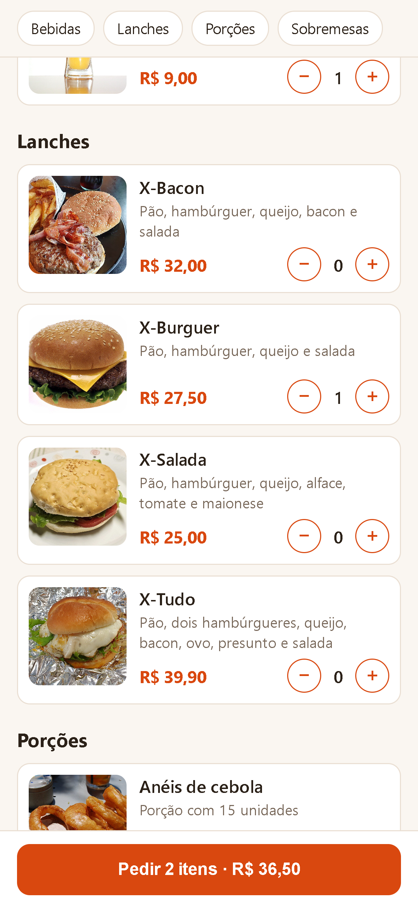
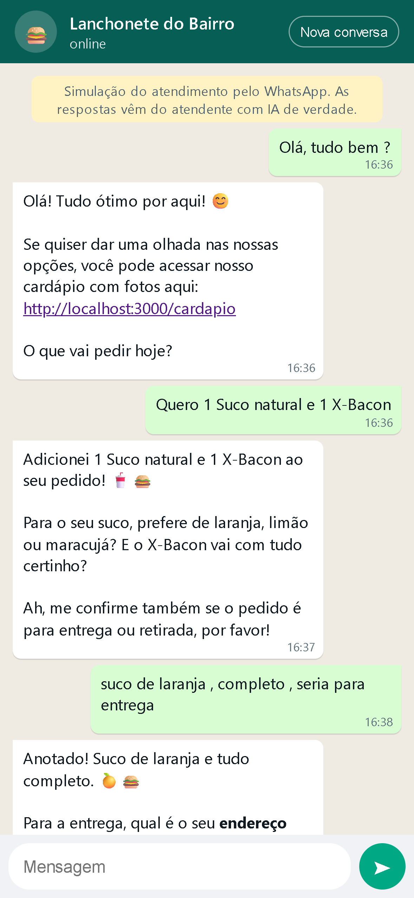

# Atendente Digital

Atendente virtual com IA para pedidos pelo WhatsApp. O cliente conversa em linguagem natural, a IA monta o pedido usando o cardápio real do banco, e o pedido é salvo com total, endereço e forma de pagamento.

A demonstração usa uma lanchonete fictícia, mas o projeto serve para qualquer negócio que vende pelo WhatsApp.

> **Status:** em desenvolvimento. A API, a IA, o cardápio digital e o simulador estão funcionando. A conexão com o WhatsApp oficial está pronta no código e aguarda a liberação da conta na Meta.

## Demonstração

| Cardápio digital | Conversa com o atendente |
|---|---|
|  |  |

## Como funciona

```
Cliente (WhatsApp ou simulador)
        │
        ▼
POST /webhook ── salva a mensagem ── IA (Gemini)
                                      │
                    chama ferramentas │ ver carrinho, adicionar e remover itens,
                     do próprio código│ confirmar pedido
                                      ▼
                         services/orders.ts ── PostgreSQL
                                      │
                                      ▼
                    resposta salva e enviada ao cliente
```

1. O cliente manda uma mensagem, como *"quero 2 x-burguer sem cebola e uma coca"*.
2. A IA recebe a mensagem, o histórico da conversa, o cardápio e o carrinho atual.
3. Quando precisa agir, a IA chama **ferramentas** (*function calling*), que executam as mesmas funções da API. Ela não inventa preços: o total é calculado pelo código.
4. Antes de confirmar, a IA mostra o resumo com o total e espera o cliente concordar. Uma **trava no código** garante essa regra, mesmo se a IA tentar pular a etapa.

## Funcionalidades

- **Atendente com IA:** entende pedidos em texto livre, tira dúvidas, ajusta itens e fecha o pedido.
- **Cardápio digital:** página com fotos, preços e categorias. O cliente escolhe os itens e volta para a conversa com o pedido pronto.
- **Simulador de WhatsApp:** página para testar e demonstrar o atendimento sem depender da Meta.
- **Pedidos:** carrinho por cliente, preço congelado na hora da compra e total calculado com `Decimal`.
- **Fluxo de status:** `DRAFT → CONFIRMED → PREPARING → OUT_FOR_DELIVERY → DELIVERED`, com cancelamento e transições inválidas bloqueadas.
- **Webhook do WhatsApp:** verificação, leitura das mensagens, mensagens repetidas ignoradas e correção do 9 dos celulares brasileiros.
- **Resiliência da IA:** nova tentativa, troca automática de modelo e pulo de modelos sem cota.

## Stack

- **Node.js + TypeScript** e **Express 5**
- **PostgreSQL + Prisma 7** (com `@prisma/adapter-pg`)
- **Zod** para validação
- **Google Gemini** (`@google/genai`) com *function calling*
- **WhatsApp Cloud API** (Meta)
- **ngrok** para expor o webhook em desenvolvimento

## Estrutura

```
prisma/
  schema.prisma          # modelos do banco
  migrations/            # histórico das migrations
public/
  cardapio.html          # cardápio digital
  simulador.html         # simulador de WhatsApp
  imagens/               # fotos dos produtos
src/
  server.ts              # rotas e tratamento de erros
  seed.ts                # cardápio de exemplo
  routes/                # rotas HTTP (validam e chamam os services)
  services/
    ai.ts                # IA: instruções, ferramentas e troca de modelo
    bot.ts               # fluxo de uma mensagem: salvar, responder, enviar
    orders.ts            # regras de negócio dos pedidos
    messages.ts          # histórico das conversas
    whatsapp.ts          # leitura do webhook e envio de mensagens
  schemas/               # schemas Zod
  lib/                   # Prisma, erros, validação e telefone
  scripts/list-models.ts # lista os modelos do Gemini disponíveis
```

A lógica fica nos **services**, separada das rotas. A IA usa as mesmas funções da API, então as regras de negócio valem para os dois.

## Como rodar

**Pré-requisitos:** Node.js 20.6+, PostgreSQL e uma chave do Gemini, gerada no [Google AI Studio](https://aistudio.google.com).

1. Clone e instale:

   ```bash
   git clone https://github.com/MaiconCasagrandaDev/atendente-digital.git
   cd atendente-digital
   npm install
   ```

2. Crie o `.env` a partir do exemplo e preencha a URL do banco e a chave do Gemini:

   ```bash
   cp .env.example .env
   ```

3. Crie as tabelas, gere o client e popule o cardápio:

   ```bash
   npx prisma migrate dev
   npx prisma generate
   npm run seed
   ```

4. Suba a API:

   ```bash
   npm run dev
   ```

5. Abra no navegador:
   - Cardápio: `http://localhost:3000/cardapio`
   - Simulador: `http://localhost:3000/simulador`

### Variáveis de ambiente

| Variável | Para que serve |
|---|---|
| `DATABASE_URL` | Conexão com o PostgreSQL |
| `PORT` | Porta da API (padrão 3000) |
| `GEMINI_API_KEY` | Chave do Google AI Studio |
| `GEMINI_MODEL` | Um ou mais modelos, separados por vírgula, em ordem de preferência |
| `STORE_NAME` | Nome da loja, mostrado no cardápio |
| `PUBLIC_URL` | Endereço público da API, usado no link do cardápio |
| `WHATSAPP_MODE` | `simulation` mostra as respostas no terminal; `live` envia pelo WhatsApp |
| `WHATSAPP_VERIFY_TOKEN` | Senha de verificação do webhook na Meta |
| `WHATSAPP_TOKEN` | Token de acesso da WhatsApp Cloud API |
| `WHATSAPP_PHONE_NUMBER_ID` | Id do número no painel da Meta |
| `WHATSAPP_DISPLAY_NUMBER` | Número da loja, usado nos links do cardápio no modo `live` |
| `GRAPH_VERSION` | Versão da Graph API da Meta |

## Scripts

| Comando | O que faz |
|---|---|
| `npm run dev` | Sobe a API com recarga automática |
| `npm run seed` | Recria o cardápio de exemplo (apaga produtos e pedidos) |
| `npx tsx --env-file=.env src/scripts/list-models.ts` | Lista os modelos do Gemini disponíveis para a chave |

## Endpoints

### Produtos

| Método | Rota | Descrição |
|---|---|---|
| GET | `/products` | Lista os produtos disponíveis |
| GET | `/products/:id` | Busca um produto |
| POST | `/products` | Cria um produto |
| PATCH | `/products/:id` | Edita só os campos enviados |
| DELETE | `/products/:id` | Desativa o produto |

### Pedidos

| Método | Rota | Descrição |
|---|---|---|
| GET | `/orders` | Lista os pedidos (filtro opcional: `?status=CONFIRMED`) |
| POST | `/orders/cart` | Busca ou cria o carrinho do cliente pelo telefone |
| GET | `/orders/:id` | Busca um pedido com itens e cliente |
| POST | `/orders/:id/items` | Adiciona um item ao carrinho |
| DELETE | `/orders/:id/items/:itemId` | Remove um item do carrinho |
| POST | `/orders/:id/confirm` | Confirma o pedido |
| PATCH | `/orders/:id/status` | Avança o status do pedido |

### WhatsApp e páginas

| Método | Rota | Descrição |
|---|---|---|
| GET | `/webhook` | Verificação do webhook pela Meta |
| POST | `/webhook` | Recebe as mensagens do WhatsApp |
| GET | `/store` | Dados públicos da loja |
| GET | `/cardapio` | Cardápio digital |
| GET | `/health` | Verifica se a API está no ar |

### Desenvolvimento (fora do modo `live`)

| Método | Rota | Descrição |
|---|---|---|
| GET | `/simulador` | Simulador de WhatsApp |
| POST | `/dev/chat` | Envia uma mensagem ao atendente e devolve a resposta |
| GET | `/dev/history?phone=` | Histórico da conversa de um telefone |

## Regras de negócio

- Só é possível confirmar um carrinho com pelo menos um item.
- Entrega exige endereço; retirada, não.
- Troco só vale para pagamento em dinheiro e precisa ser maior ou igual ao total.
- Pedido confirmado não aceita mais alterações de itens.
- Pedido para retirada não passa por "saiu para entrega".
- A IA só confirma depois de mostrar o resumo com o total atual e o cliente concordar.

## Roadmap

- [x] API de cardápio e pedidos
- [x] Webhook do WhatsApp
- [x] Atendente com IA usando *function calling*
- [x] Simulador de WhatsApp
- [x] Cardápio digital com fotos
- [ ] Número oficial do WhatsApp em produção
- [ ] Aviso ao dono quando chega pedido e passagem para atendente humano
- [ ] Painel do dono em React + Vite
- [ ] Deploy
- [ ] Escolha do provedor de IA por loja

## Autor

**Maicon Casagranda** — [GitHub](https://github.com/MaiconCasagrandaDev)